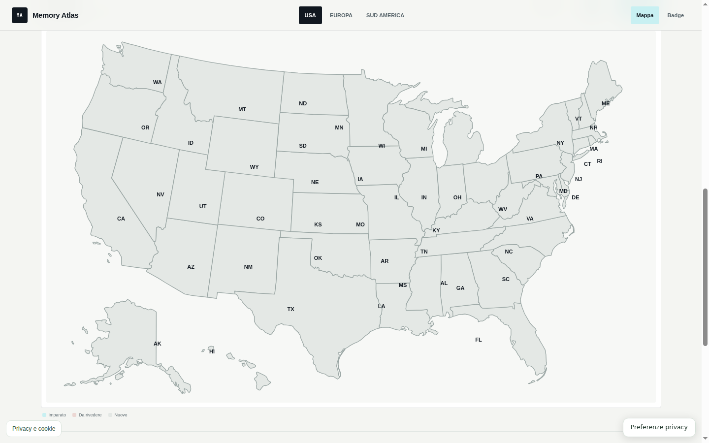
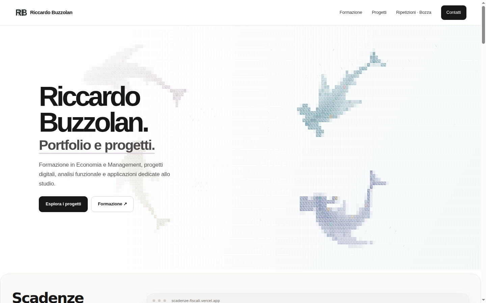
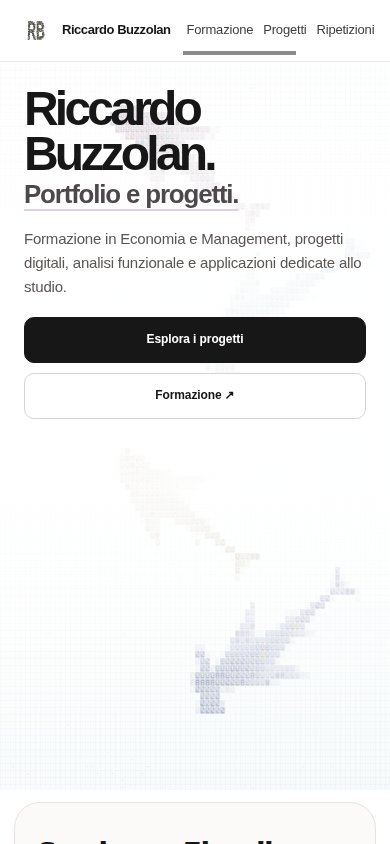
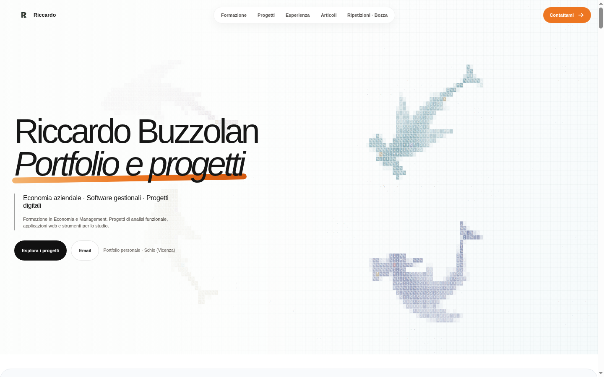

# Riccardo Buzzolan

Mi interessano la digitalizzazione, la gamification e l'uso degli strumenti digitali per organizzare informazioni e attività.

Ho provato a realizzare alcuni siti e applicazioni per fare pratica e capire meglio come funzionano. In parallelo sto approfondendo Power BI, SQL e processi ERP.

[Portfolio](https://riccardobuzzolan.github.io/) · [LinkedIn](https://www.linkedin.com/in/riccardobuzzolan/)

## Progetti

### Scadenze fiscali

[Apri il sito](https://scadenze-fiscali.vercel.app/)

Un calendario delle principali scadenze fiscali italiane, organizzato per rendere più semplice la consultazione di date, adempimenti e approfondimenti.

**Funzionalità**
- Calendario 2026, filtri per periodo e tipologia, pagine dedicate alle singole scadenze e guide collegate.
- Preferiti salvati nel browser ed esportazione delle scadenze in formato iCalendar (`.ics`).
- Un'area di lavoro con raccolte, checklist, viste temporali ed esportazione di riepiloghi in PDF.

**Come è realizzato:** Astro e TypeScript, con dati delle scadenze gestiti in una sorgente centrale e pagine generate in fase di build. Il sito è pubblicato su Vercel. Le informazioni fiscali richiedono verifiche e aggiornamenti rispetto alle fonti ufficiali.

*Il repository di sviluppo è privato.*

### Memory Atlas

[Prova il quiz](https://riccardobuzzolan.github.io/imparacapitalistati/) · [Repository](https://github.com/riccardobuzzolan/imparacapitalistati)

Un progetto di gamification per esercitarsi sulle capitali di Stati Uniti, Europa e Sud America tramite mappe interattive.

**Funzionalità**
- Selezione degli stati o dei Paesi sulla mappa, domande sulle capitali e verifica delle risposte.
- Modalità quiz rapido, avanzamento dell'apprendimento e riepilogo dei risultati.
- Progressi salvati nel browser, con esportazione e importazione di backup JSON.

**Come è realizzato:** TypeScript e Vite, mappe SVG, logica del quiz separata dai dati geografici e salvataggio locale. È disponibile anche come PWA, utilizzabile offline dopo il primo caricamento completo.

Schermata mobile

### Sito personale

[Apri il sito](https://riccardobuzzolan.github.io/) · [Repository](https://github.com/riccardobuzzolan/riccardobuzzolan.github.io)

Il mio sito personale, con informazioni sulle ripetizioni, alcuni progetti e i contatti.

**Come è realizzato:** HTML, CSS e JavaScript senza framework applicativi o backend. Layout responsive, sezioni navigabili anche da tastiera, animazioni che rispettano le preferenze di movimento ridotto e collegamenti ai progetti. Pubblicato tramite GitHub Pages.

Schermata mobile

### Sito ripetizioni

[Apri il sito](https://riccardobuzzolan.github.io/SitoRiccardoBuzzolan/) · [Repository](https://github.com/riccardobuzzolan/SitoRiccardoBuzzolan)

Una pagina dedicata alle ripetizioni a Schio, Vicenza e online, con informazioni sui servizi, contenuti del percorso personale e modalità di contatto.

**Funzionalità e struttura**
- Pagine e sezioni adattate a desktop e smartphone, con navigazione e contenuti interattivi.
- Pannello di contatto che prepara un messaggio WhatsApp o un'email, senza raccogliere le richieste su un server.
- Interazioni accessibili da tastiera e contenuti esterni caricati in base alle preferenze del visitatore.

**Tecnologie:** HTML, CSS e JavaScript; pubblicazione principale su GitHub Pages.

Schermata mobile

## Strumenti e argomenti di studio

**Utilizzati nei progetti:** HTML, CSS, JavaScript, TypeScript, Astro, GitHub Pages e Vercel.

**Sto approfondendo:** Power BI, SQL, analisi dei dati e processi ERP.

## Contatti

[LinkedIn](https://www.linkedin.com/in/riccardobuzzolan/) · [Sito personale](https://riccardobuzzolan.github.io/)

Informazioni tecniche su questo repository

Questo repository mantiene alcuni vecchi collegamenti al portfolio. Il sito attuale si trova in [riccardobuzzolan.github.io](https://github.com/riccardobuzzolan/riccardobuzzolan.github.io).

Configurazione e manutenzione: [docs/TECHNICAL.md](docs/TECHNICAL.md).

