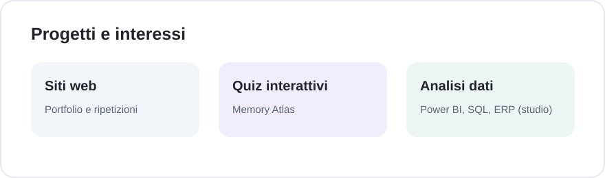

# Riccardo Buzzolan

Mi interessano i progetti digitali che risolvono problemi concreti: un sito facile da consultare, un quiz per imparare, uno strumento per trovare informazioni senza perdersi tra pagine diverse.

Sviluppo e aggiorno siti e piccole applicazioni web. In parallelo sto approfondendo Power BI, SQL e processi ERP, con l'obiettivo di collegare le competenze digitali all'analisi aziendale.

## Progetti

### Sito personale

[Apri il sito](https://riccardobuzzolan.github.io/) · [Codice](https://github.com/riccardobuzzolan/riccardobuzzolan.github.io)

Sito personale con informazioni sulle ripetizioni, progetti e contatti.

### Ripetizioni

[Apri il sito](https://riccardobuzzolan.github.io/SitoRiccardoBuzzolan/) · [Codice](https://github.com/riccardobuzzolan/SitoRiccardoBuzzolan)

Una pagina dedicata alle ripetizioni a Schio, Vicenza e online, con contenuti e contatto tramite WhatsApp o email.

### Memory Atlas

[Apri il quiz](https://riccardobuzzolan.github.io/imparacapitalistati/) · [Codice](https://github.com/riccardobuzzolan/imparacapitalistati)

Quiz sulle capitali di Stati Uniti, Europa e Sud America. I progressi sono salvati nel browser ed esportabili in JSON.

### Scadenze fiscali

[Apri il sito](https://scadenze-fiscali.vercel.app/)

Un sito per consultare le scadenze fiscali italiane. Il repository di sviluppo non è pubblico.

## Strumenti

Nei progetti web utilizzo HTML, CSS, JavaScript e, quando serve, TypeScript. Per pubblicare uso GitHub Pages e Vercel. Power BI, SQL ed ERP sono ambiti che sto studiando: non li presento come progetti già terminati.

## Contatti

- [LinkedIn](https://www.linkedin.com/in/riccardobuzzolan/)
- [Sito personale](https://riccardobuzzolan.github.io/)

*Le immagini mostrano le versioni desktop dei siti pubblicati.*

## Informazioni sul repository

Questo repository mantiene attivi alcuni vecchi collegamenti al portfolio. Il sito attuale si trova in [riccardobuzzolan.github.io](https://github.com/riccardobuzzolan/riccardobuzzolan.github.io). La configurazione e le istruzioni di manutenzione sono in [docs/TECHNICAL.md](docs/TECHNICAL.md).
